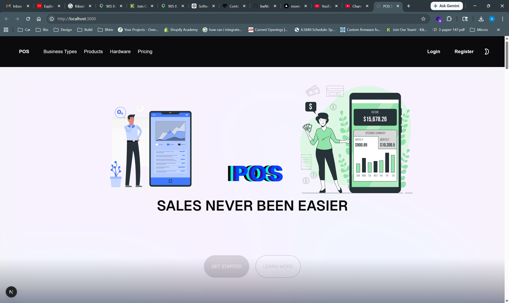

This is a [Next.js](https://nextjs.org) project bootstrapped with [`create-next-app`](https://nextjs.org/docs/app/api-reference/cli/create-next-app).

## Demo Video

[](https://youtu.be/HpIIT2wax2g)

```text
                 POS DATABASE
                      │
          ┌───────────┴───────────┐
          │                       │
      Spring Boot              SQL
       REST API               queries
          │                       │
          └───────────┬───────────┘
                      │
                    Next.js
                      │
             ┌────────┴────────┐
             │                 │
          POS UI          Analytics
```

```text
        users
        │
        ├── user_roles
        │       │
        │       └── roles
        │
        └── shop_users
                │
                └── shops
                        │
                        └── registers
                                │
                                └── sales
                                    │
                                    ├── sale_items
                                    │      │
                                    │      └── products
                                    │
                                    └── payments
```

```text
        Today's Sales       $4,382.25

        Transactions             127

        Average Order          $34.51

        Top Product
        └── Widget A          83 sold

        Sales by Shop
        ├── Shop A          $2,431
        ├── Shop B          $1,284
        └── Shop C            $667
```

```text
                                 ┌───────────┐
                                 │  users    │
                                 └─────┬─────┘
                                       │
                                       │
        ┌───────────┐             ┌────▼─────┐
        │   shops   │────────────►│  sales   │
        └───────────┘             └────┬─────┘
                                       │
                            ┌──────────┴──────────┐
                            │                     │
                      ┌─────▼──────┐        ┌─────▼──────┐
                      │ sale_items │        │  payments  │
                      └─────┬──────┘        └────────────┘
                            │
                            │
                      ┌─────▼──────┐
                      │  products  │
                      └────────────┘
```

This is where your question about @OneToMany and @ManyToMany is important.

You actually don't want a @ManyToMany between Sale and Product directly.

Conceptually, yes:

```text
    Sale       Product
    │           │
    │ many      │ many
    └─────┬─────┘
            │
        sale_items
```

A sale can contain many products.

A product can appear in many sales.

So mathematically that's a many-to-many relationship.

But sale_items has additional information:

quantity
unit_price
subtotal

That makes SaleItem an association entity.

So your JPA model should be:

```text
Sale
 │
 │ @OneToMany
 ▼
SaleItem
 │
 │ @ManyToOne
 ▼
Product
```

```text
----------------
Creating Tables
----------------

CREATE TABLE users (
    id SERIAL PRIMARY KEY,
    email VARCHAR(255) UNIQUE NOT NULL,
    username VARCHAR(100) NOT NULL,
    password TEXT NOT NULL
);

CREATE TABLE roles (
    id SERIAL PRIMARY KEY,
    name VARCHAR(255) NOT NULL
);

CREATE TABLE user_roles (
    user_id BIGINT NOT NULL,
    role_id BIGINT NOT NULL, PRIMARY KEY (user_id, role_id), FOREIGN KEY (user_id) REFERENCES users(id) ON DELETE CASCADE, FOREIGN KEY (role_id) REFERENCES roles(id) ON DELETE CASCADE
);

--------------
Adding roles
--------------

insert into roles (name)
values ('ROLE_ADMIN');

create index idx_user_username on users(username);
create index idx_role_name on roles(name);

insert into roles (name)
values ('ROLE_USER');

---

CREATE TABLE shops (
    id SERIAL PRIMARY KEY,
    user_id INTEGER REFERENCES users(id) ON DELETE CASCADE,
    name VARCHAR(255) NOT NULL,
    location VARCHAR(255)
);

CREATE TABLE products (
    id BIGSERIAL PRIMARY KEY,
    name VARCHAR(150) NOT NULL,
    description TEXT,
    sku VARCHAR(50) NOT NULL UNIQUE,
    price NUMERIC(10, 2) NOT NULL CHECK (price >= 0),
    stock_quantity INTEGER NOT NULL DEFAULT 0 CHECK (stock_quantity >= 0),
    active BOOLEAN NOT NULL DEFAULT TRUE,
    created_at TIMESTAMP NOT NULL DEFAULT CURRENT_TIMESTAMP,
    updated_at TIMESTAMP NOT NULL DEFAULT CURRENT_TIMESTAMP
);

----------------
Adding Products
----------------

INSERT INTO products
    (name, description, sku, price, stock_quantity, active)
VALUES
    ('Classic Burger',
     'Beef burger with lettuce, tomato, and onion',
     'BURG-001',
     8.99,
     50,
     TRUE),

    ('Cheeseburger',
     'Classic burger with American cheese',
     'BURG-002',
     10.99,
     45,
     TRUE),

    ('French Fries',
     'Crispy seasoned french fries',
     'SIDE-001',
     3.49,
     100,
     TRUE),

    ('Chicken Sandwich',
     'Grilled chicken sandwich with lettuce and tomato',
     'SAND-001',
     9.49,
     40,
     TRUE),

    ('Coca-Cola',
     '20 oz bottled Coca-Cola',
     'DRINK-001',
     2.49,
     75,
     TRUE),

    ('Chocolate Cake',
     'Slice of chocolate cake',
     'DESS-001',
     5.99,
     25,
     TRUE);

---

CREATE TABLE sales (
    id BIGSERIAL PRIMARY KEY,
    shop_id BIGINT NOT NULL,
    user_id BIGINT NOT NULL,

    subtotal NUMERIC(10, 2) NOT NULL CHECK (subtotal >= 0),
    tax NUMERIC(10, 2) NOT NULL DEFAULT 0 CHECK (tax >= 0),
    discount NUMERIC(10, 2) NOT NULL DEFAULT 0 CHECK (discount >= 0),
    total NUMERIC(10, 2) NOT NULL CHECK (total >= 0),

    status VARCHAR(30) NOT NULL DEFAULT 'COMPLETED',

    created_at TIMESTAMP NOT NULL DEFAULT CURRENT_TIMESTAMP,

    CONSTRAINT fk_sales_shop
        FOREIGN KEY (shop_id)
        REFERENCES shops(id),

    CONSTRAINT fk_sales_user
        FOREIGN KEY (user_id)
        REFERENCES users(id)
);

CREATE TABLE sale_items (
    id BIGSERIAL PRIMARY KEY,

    sale_id BIGINT NOT NULL,
    product_id BIGINT NOT NULL,

    quantity INTEGER NOT NULL CHECK (quantity > 0),
    unit_price NUMERIC(10, 2) NOT NULL CHECK (unit_price >= 0),
    subtotal NUMERIC(10, 2) NOT NULL CHECK (subtotal >= 0),

    CONSTRAINT fk_sale_items_sale
        FOREIGN KEY (sale_id)
        REFERENCES sales(id)
        ON DELETE CASCADE,

    CONSTRAINT fk_sale_items_product
        FOREIGN KEY (product_id)
        REFERENCES products(id)
);

CREATE TABLE payments (
    id BIGSERIAL PRIMARY KEY,

    sale_id BIGINT NOT NULL,

    payment_method VARCHAR(30) NOT NULL,
    amount NUMERIC(10, 2) NOT NULL CHECK (amount > 0),

    status VARCHAR(30) NOT NULL DEFAULT 'COMPLETED',

    transaction_reference VARCHAR(150),

    created_at TIMESTAMP NOT NULL DEFAULT CURRENT_TIMESTAMP,

    CONSTRAINT fk_payments_sale
        FOREIGN KEY (sale_id)
        REFERENCES sales(id)
        ON DELETE CASCADE
);

-----------------------------------------
Adding Sales W/ Sale_Items and Payments
-----------------------------------------

INSERT INTO sales
    (shop_id, user_id, subtotal, tax, discount, total, status)
VALUES
    (1, 3, 26.45, 2.12, 0.00, 28.57, 'COMPLETED');

INSERT INTO sales
    (shop_id, user_id, subtotal, tax, discount, total, status)
VALUES
    (1, 3, 16.97, 1.36, 0.00, 18.33, 'COMPLETED');

INSERT INTO sales
    (shop_id, user_id, subtotal, tax, discount, total, status)
VALUES
    (1, 3, 18.97, 1.52, 0.00, 20.49, 'COMPLETED');

----

INSERT INTO sale_items
    (sale_id, product_id, quantity, unit_price, subtotal)
VALUES
    (1, 1, 2, 8.99, 17.98),
    (1, 3, 1, 3.49, 3.49),
    (1, 5, 2, 2.49, 4.98);

INSERT INTO sale_items
    (sale_id, product_id, quantity, unit_price, subtotal)
VALUES
    (2, 2, 1, 10.99, 10.99),
    (2, 3, 1, 3.49, 3.49),
    (2, 5, 1, 2.49, 2.49);

INSERT INTO sale_items
    (sale_id, product_id, quantity, unit_price, subtotal)
VALUES
    (3, 4, 1, 9.49, 9.49),
    (3, 3, 1, 3.49, 3.49),
    (3, 6, 1, 5.99, 5.99);

---

INSERT INTO payments
    (sale_id, payment_method, amount, status, transaction_reference)
VALUES
    (1, 'CARD', 28.57, 'COMPLETED', 'TXN-100001');

INSERT INTO payments
    (sale_id, payment_method, amount, status, transaction_reference)
VALUES
    (2, 'CASH', 18.33, 'COMPLETED', NULL);

INSERT INTO payments
    (sale_id, payment_method, amount, status, transaction_reference)
VALUES
    (3, 'CARD', 20.49, 'COMPLETED', 'TXN-100002');

---
All Table Schemas
SELECT
    table_name,
    ordinal_position,
    column_name,
    data_type,
    is_nullable,
    column_default
FROM information_schema.columns
WHERE table_schema = 'public'
ORDER BY table_name, ordinal_position;

-------------------------
Foreign Keys/Constraints
-------------------------

SELECT
    tc.table_name,
    tc.constraint_name,
    tc.constraint_type,
    kcu.column_name,
    ccu.table_name AS referenced_table,
    ccu.column_name AS referenced_column
FROM information_schema.table_constraints tc
LEFT JOIN information_schema.key_column_usage kcu
    ON tc.constraint_name = kcu.constraint_name
    AND tc.constraint_schema = kcu.constraint_schema
LEFT JOIN information_schema.constraint_column_usage ccu
    ON tc.constraint_name = ccu.constraint_name
    AND tc.constraint_schema = ccu.constraint_schema
WHERE tc.table_schema = 'public'
ORDER BY tc.table_name, tc.constraint_type;

------------------------
Table Constraints/Rules
------------------------

SELECT
    conrelid::regclass AS table_name,
    conname AS constraint_name,
    pg_get_constraintdef(oid) AS definition
FROM pg_constraint
WHERE connamespace = 'public'::regnamespace
ORDER BY conrelid::regclass::text, conname;

--------------------
Showing All Tables
-----------------

SELECT id, name, sku, price, stock_quantity, active
FROM products
ORDER BY id;

SELECT id, user_id, name, location
FROM shops
ORDER BY id;

SELECT id, username
FROM users
ORDER BY id;


SELECT id, shop_id, user_id, subtotal, tax,
       discount, total, status, created_at
FROM sales
ORDER BY id;

SELECT id, sale_id, product_id, quantity,
       unit_price, subtotal
FROM sale_items
ORDER BY id;

SELECT id, sale_id, payment_method, amount,
       status, created_at
FROM payments
ORDER BY id;

---------------

---------------

```

*Security Configurations*
These paths are given authorization in securityConfig

- /auth/** permitAll
- /api/users/** hasRole(Admin)
- /users/** hasRole(Admin)
- /roles/** hasRole(Admin)
- /shops/** hasRole(user, Admin)

Backend API Endpoints
*HoneyPot Controller*
--> /
    - /admin
    - /login
    - /signin
    ...

*Authentication* (All Permissions)
--> /auth
1    - /login-refresh
2    - /register-refresh
3    - /logout-refresh
4    - /refresh

*Shop Controller*
--> /shops
5    - /{shopId} GET
6    - /{shopId} DELETE
7    - /{id} PUT
8    - /addShop

*User Controller*
--> /api
9     - /users    (admin permissions)
10    - /profile
11    - / delete

*UserData Controller*
--> /api/userData
12    - /{username}/data

*Default Paths from @RestController and starter-data-rest dependency*
--> All have GET /, Get /.../{id}, POST /, PUT /.../{id}, DELETE /.../{id}
13    - /payments (unused)
14    - /products (unused)
15    - /roles
16    - /saleItems (unused)
17    - /shops
18    - /userData ? (unused)
19    - /users

(Analytics)
*Product Controller*
--> /api/products
20    - /total-units-sold

(Analytics)
*Sale Controller*
--> /api/sales
21    - /all-sales
22    - /daily-revenue
23    - /{shopId}/average-sale

(Analytics)
*Product Report Controller*
--> /api/shops
24    - /sales-report
25    - /{shopId}/sales-report
26    - /{shopId}/reports/top-products-units
27    - /{shopId}/reports/top-products-revenue
28    - /{shopId}/reports/sales-by-date/{startDate}/{endDate}

Frontend API Endpoints

*AuthContext*
1 Login --> /auth/login-refresh
2 register --> /auth/register-refresh
3 logout --> /auth/logout-refresh
4 checkRefresh --> /auth/refresh

5 deleteProfile --> /api/delete

6 fetchShop --> /shops/{shopId}   GET
7 addShop --> /shops/addShop      POST
8 updateShop --> /shops/{shopId}  PUT
9 deleteShop --> /shops/{shopId}  DELETE

10 fetchProfile --> /api/profile
11 fetchUsersWithDetails --> /api/users
12 fetchUserDataObject --> /api/userData/{username}/data

13 fetchUsers --> /users
14 fetchShops --> /shops
15 fetchRoles --> /roles

(Analytics)
16 fetchAnalytics --> Calls these functions, Does Not Require any data to be passed in
17         - fetchProductSalesReport --> /api/shops/sales-report
18         - fetchAllSalesByUsers --> /api/sales/all-sales
19         - fetchDailyRevenue --> /api/sales/daily-revenue
20         - fetchTotalUnitsSoldPerProduct --> /api/products/total-untis-sold
21 fetchAverageSaleByShopId --> /api/sales/{shopId}/average-sale
22 fetchProductSalesReportById --> /api/shops/{shopId}/sales-report
23 fetchTopProductsUnits --> /reports/top-products-units
24 fetchTopProductsRevenue --> /reports/top-products-revenue
