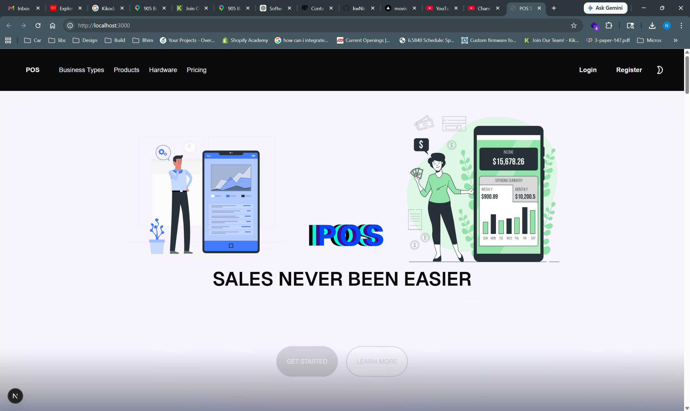

This is a [Next.js](https://nextjs.org) project bootstrapped with [`create-next-app`](https://nextjs.org/docs/app/api-reference/cli/create-next-app).

## Demo Video

[](https://youtu.be/HpIIT2wax2g)

```text
                 POS DATABASE
                      │
          ┌───────────┴───────────┐
          │                       │
      Spring Boot              SQL
       REST API               queries
          │                       │
          └───────────┬───────────┘
                      │
                    Next.js
                      │
             ┌────────┴────────┐
             │                 │
          POS UI          Analytics
```

```text
        users
        │
        ├── user_roles
        │       │
        │       └── roles
        │
        └── shop_users
                │
                └── shops
                      │
                      └── registers
                              │
                              └── sales
                                    │
                                    ├── sale_items
                                    │      │
                                    │      └── products
                                    │
                                    └── payments
```

```text
        Today's Sales       $4,382.25

        Transactions             127

        Average Order          $34.51

        Top Product
        └── Widget A          83 sold

        Sales by Shop
        ├── Shop A          $2,431
        ├── Shop B          $1,284
        └── Shop C            $667
```

```text
                                 ┌───────────┐
                                 │  users    │
                                 └─────┬─────┘
                                       │
                                       │
        ┌───────────┐             ┌────▼─────┐
        │   shops   │────────────►│  sales   │
        └───────────┘             └────┬─────┘
                                       │
                            ┌──────────┴──────────┐
                            │                     │
                      ┌─────▼──────┐        ┌─────▼──────┐
                      │ sale_items │        │  payments  │
                      └─────┬──────┘        └─────┬──────┘
                            │                     │
                            │               ┌─────▼──────┐
                      ┌─────▼──────┐        │  employees  │
                      │  products  │        └────────────┘
                      └────────────┘
```

This is where your question about @OneToMany and @ManyToMany is important.

You actually don't want a @ManyToMany between Sale and Product directly.

Conceptually, yes:

```text
   Sale      Product
    │           │
    │ many      │ many
    └─────┬─────┘
          │
      sale_items
```

A sale can contain many products.

A product can appear in many sales.

So mathematically that's a many-to-many relationship.

But sale_items has additional information:

quantity
unit_price
subtotal

That makes SaleItem an association entity.

So your JPA model should be:

```text
       Sale
        │
        │ @OneToMany
        ▼
      SaleItem
        │
        │ @ManyToOne
        ▼
      Product
```

```text
----------------
Creating Tables
----------------

CREATE TABLE users (
    id SERIAL PRIMARY KEY,
    email VARCHAR(255) UNIQUE NOT NULL,
    username VARCHAR(100) NOT NULL,
    password TEXT NOT NULL
);

CREATE TABLE roles (
    id SERIAL PRIMARY KEY,
    name VARCHAR(255) NOT NULL
);

CREATE TABLE user_roles (
    user_id BIGINT NOT NULL,
    role_id BIGINT NOT NULL, PRIMARY KEY (user_id, role_id), FOREIGN KEY (user_id) REFERENCES users(id) ON DELETE CASCADE, FOREIGN KEY (role_id) REFERENCES roles(id) ON DELETE CASCADE
);

--------------
Adding roles
--------------

insert into roles (name)
values ('ROLE_ADMIN');

create index idx_user_username on users(username);
create index idx_role_name on roles(name);

insert into roles (name)
values ('ROLE_USER');

---

CREATE TABLE shops (
    id SERIAL PRIMARY KEY,
    user_id INTEGER REFERENCES users(id) ON DELETE CASCADE,
    name VARCHAR(255) NOT NULL,
    location VARCHAR(255)
);

CREATE TABLE products (
    id BIGSERIAL PRIMARY KEY,
    name VARCHAR(150) NOT NULL,
    description TEXT,
    sku VARCHAR(50) NOT NULL UNIQUE,
    price NUMERIC(10, 2) NOT NULL CHECK (price >= 0),
    stock_quantity INTEGER NOT NULL DEFAULT 0 CHECK (stock_quantity >= 0),
    active BOOLEAN NOT NULL DEFAULT TRUE,
    created_at TIMESTAMP NOT NULL DEFAULT CURRENT_TIMESTAMP,
    updated_at TIMESTAMP NOT NULL DEFAULT CURRENT_TIMESTAMP
);

----------------
Adding Products
----------------

INSERT INTO products
    (name, description, sku, price, stock_quantity, active)
VALUES
    ('Classic Burger',
     'Beef burger with lettuce, tomato, and onion',
     'BURG-001',
     8.99,
     50,
     TRUE),

    ('Cheeseburger',
     'Classic burger with American cheese',
     'BURG-002',
     10.99,
     45,
     TRUE),

    ('French Fries',
     'Crispy seasoned french fries',
     'SIDE-001',
     3.49,
     100,
     TRUE),

    ('Chicken Sandwich',
     'Grilled chicken sandwich with lettuce and tomato',
     'SAND-001',
     9.49,
     40,
     TRUE),

    ('Coca-Cola',
     '20 oz bottled Coca-Cola',
     'DRINK-001',
     2.49,
     75,
     TRUE),

    ('Chocolate Cake',
     'Slice of chocolate cake',
     'DESS-001',
     5.99,
     25,
     TRUE);

---

CREATE TABLE sales (
    id BIGSERIAL PRIMARY KEY,
    shop_id BIGINT NOT NULL,
    user_id BIGINT NOT NULL,

    subtotal NUMERIC(10, 2) NOT NULL CHECK (subtotal >= 0),
    tax NUMERIC(10, 2) NOT NULL DEFAULT 0 CHECK (tax >= 0),
    discount NUMERIC(10, 2) NOT NULL DEFAULT 0 CHECK (discount >= 0),
    total NUMERIC(10, 2) NOT NULL CHECK (total >= 0),

    status VARCHAR(30) NOT NULL DEFAULT 'COMPLETED',

    created_at TIMESTAMP NOT NULL DEFAULT CURRENT_TIMESTAMP,

    CONSTRAINT fk_sales_shop
        FOREIGN KEY (shop_id)
        REFERENCES shops(id),

    CONSTRAINT fk_sales_user
        FOREIGN KEY (user_id)
        REFERENCES users(id)
);

CREATE TABLE sale_items (
    id BIGSERIAL PRIMARY KEY,

    sale_id BIGINT NOT NULL,
    product_id BIGINT NOT NULL,

    quantity INTEGER NOT NULL CHECK (quantity > 0),
    unit_price NUMERIC(10, 2) NOT NULL CHECK (unit_price >= 0),
    subtotal NUMERIC(10, 2) NOT NULL CHECK (subtotal >= 0),

    CONSTRAINT fk_sale_items_sale
        FOREIGN KEY (sale_id)
        REFERENCES sales(id)
        ON DELETE CASCADE,

    CONSTRAINT fk_sale_items_product
        FOREIGN KEY (product_id)
        REFERENCES products(id)
);

CREATE TABLE payments (
    id BIGSERIAL PRIMARY KEY,

    sale_id BIGINT NOT NULL,

    payment_method VARCHAR(30) NOT NULL,
    amount NUMERIC(10, 2) NOT NULL CHECK (amount > 0),

    status VARCHAR(30) NOT NULL DEFAULT 'COMPLETED',

    transaction_reference VARCHAR(150),

    created_at TIMESTAMP NOT NULL DEFAULT CURRENT_TIMESTAMP,

    CONSTRAINT fk_payments_sale
        FOREIGN KEY (sale_id)
        REFERENCES sales(id)
        ON DELETE CASCADE
);

-----------------------------------------
Adding Sales W/ Sale_Items and Payments
-----------------------------------------

INSERT INTO sales
    (shop_id, user_id, subtotal, tax, discount, total, status)
VALUES
    (1, 3, 26.45, 2.12, 0.00, 28.57, 'COMPLETED');

INSERT INTO sales
    (shop_id, user_id, subtotal, tax, discount, total, status)
VALUES
    (1, 3, 16.97, 1.36, 0.00, 18.33, 'COMPLETED');

INSERT INTO sales
    (shop_id, user_id, subtotal, tax, discount, total, status)
VALUES
    (1, 3, 18.97, 1.52, 0.00, 20.49, 'COMPLETED');

----

INSERT INTO sale_items
    (sale_id, product_id, quantity, unit_price, subtotal)
VALUES
    (1, 1, 2, 8.99, 17.98),
    (1, 3, 1, 3.49, 3.49),
    (1, 5, 2, 2.49, 4.98);

INSERT INTO sale_items
    (sale_id, product_id, quantity, unit_price, subtotal)
VALUES
    (2, 2, 1, 10.99, 10.99),
    (2, 3, 1, 3.49, 3.49),
    (2, 5, 1, 2.49, 2.49);

INSERT INTO sale_items
    (sale_id, product_id, quantity, unit_price, subtotal)
VALUES
    (3, 4, 1, 9.49, 9.49),
    (3, 3, 1, 3.49, 3.49),
    (3, 6, 1, 5.99, 5.99);

---

INSERT INTO payments
    (sale_id, payment_method, amount, status, transaction_reference)
VALUES
    (1, 'CARD', 28.57, 'COMPLETED', 'TXN-100001');

INSERT INTO payments
    (sale_id, payment_method, amount, status, transaction_reference)
VALUES
    (2, 'CASH', 18.33, 'COMPLETED', NULL);

INSERT INTO payments
    (sale_id, payment_method, amount, status, transaction_reference)
VALUES
    (3, 'CARD', 20.49, 'COMPLETED', 'TXN-100002');

-------------------------
Creating Employees Table
-------------------------

CREATE TABLE employees (
    id BIGINT GENERATED BY DEFAULT AS IDENTITY PRIMARY KEY,

    shop_id BIGINT NOT NULL,

    first_name VARCHAR(100) NOT NULL,
    last_name VARCHAR(100) NOT NULL,

    pin_hash VARCHAR(255) NOT NULL,

    position VARCHAR(50) NOT NULL,

    active BOOLEAN NOT NULL DEFAULT TRUE,

    created_at TIMESTAMP DEFAULT CURRENT_TIMESTAMP,

    CONSTRAINT fk_employees_shop
        FOREIGN KEY (shop_id)
        REFERENCES shops(id)
        ON DELETE CASCADE,

    CONSTRAINT unique_employee_pin_per_shop
        UNIQUE (shop_id, pin_hash)
);

------------------
All Table Schemas
------------------

SELECT
    table_name,
    ordinal_position,
    column_name,
    data_type,
    is_nullable,
    column_default
FROM information_schema.columns
WHERE table_schema = 'public'
ORDER BY table_name, ordinal_position;

-------------------------
Foreign Keys/Constraints
-------------------------

SELECT
    tc.table_name,
    tc.constraint_name,
    tc.constraint_type,
    kcu.column_name,
    ccu.table_name AS referenced_table,
    ccu.column_name AS referenced_column
FROM information_schema.table_constraints tc
LEFT JOIN information_schema.key_column_usage kcu
    ON tc.constraint_name = kcu.constraint_name
    AND tc.constraint_schema = kcu.constraint_schema
LEFT JOIN information_schema.constraint_column_usage ccu
    ON tc.constraint_name = ccu.constraint_name
    AND tc.constraint_schema = ccu.constraint_schema
WHERE tc.table_schema = 'public'
ORDER BY tc.table_name, tc.constraint_type;

------------------------
Table Constraints/Rules
------------------------

SELECT
    conrelid::regclass AS table_name,
    conname AS constraint_name,
    pg_get_constraintdef(oid) AS definition
FROM pg_constraint
WHERE connamespace = 'public'::regnamespace
ORDER BY conrelid::regclass::text, conname;

--------------------
Showing All Tables
-----------------

SELECT id, name, sku, price, stock_quantity, active
FROM products
ORDER BY id;

SELECT id, user_id, name, location
FROM shops
ORDER BY id;

SELECT id, username
FROM users
ORDER BY id;


SELECT id, shop_id, user_id, subtotal, tax,
       discount, total, status, created_at
FROM sales
ORDER BY id;

SELECT id, sale_id, product_id, quantity,
       unit_price, subtotal
FROM sale_items
ORDER BY id;

SELECT id, sale_id, payment_method, amount,
       status, created_at
FROM payments
ORDER BY id;

---------------
Adding 30 Tables
---------------

BEGIN;

WITH sale_seed (sale_no, shop_id, user_id, employee_id, created_at, product_offset) AS (
    VALUES
    -- Burger Town 1: shop_id 1
    ( 1, 1, 3, 1, TIMESTAMP '2026-05-08 10:15:00', 0),
    ( 2, 1, 3, 2, TIMESTAMP '2026-05-17 13:30:00', 1),
    ( 3, 1, 3, 1, TIMESTAMP '2026-05-29 17:45:00', 2),
    ( 4, 1, 3, 2, TIMESTAMP '2026-06-06 11:20:00', 3),
    ( 5, 1, 3, 1, TIMESTAMP '2026-06-19 14:10:00', 4),
    ( 6, 1, 3, 2, TIMESTAMP '2026-06-28 18:35:00', 5),
    ( 7, 1, 3, 1, TIMESTAMP '2026-07-09 12:05:00', 1),
    ( 8, 1, 3, 2, TIMESTAMP '2026-07-21 16:40:00', 2),
    ( 9, 1, 3, 1, TIMESTAMP '2026-08-03 10:50:00', 3),
    (10, 1, 3, 2, TIMESTAMP '2026-08-18 19:15:00', 4),
    (11, 1, 3, 1, TIMESTAMP '2026-09-04 13:25:00', 5),
    (12, 1, 3, 2, TIMESTAMP '2026-09-22 17:10:00', 0),
    (13, 1, 3, 1, TIMESTAMP '2026-10-07 11:45:00', 1),
    (14, 1, 3, 2, TIMESTAMP '2026-10-23 15:30:00', 2),
    (15, 1, 3, 1, TIMESTAMP '2026-11-03 18:20:00', 3),

    -- Burger Town 2: shop_id 3
    (16, 3, 3, 3, TIMESTAMP '2026-05-11 11:10:00', 2),
    (17, 3, 3, 3, TIMESTAMP '2026-05-24 16:25:00', 3),
    (18, 3, 3, 3, TIMESTAMP '2026-06-03 12:40:00', 4),
    (19, 3, 3, 3, TIMESTAMP '2026-06-15 18:05:00', 5),
    (20, 3, 3, 3, TIMESTAMP '2026-06-26 14:50:00', 0),
    (21, 3, 3, 3, TIMESTAMP '2026-07-07 10:35:00', 1),
    (22, 3, 3, 3, TIMESTAMP '2026-07-19 17:20:00', 2),
    (23, 3, 3, 3, TIMESTAMP '2026-08-09 13:15:00', 3),
    (24, 3, 3, 3, TIMESTAMP '2026-08-25 19:30:00', 4),
    (25, 3, 3, 3, TIMESTAMP '2026-09-08 11:55:00', 5),
    (26, 3, 3, 3, TIMESTAMP '2026-09-25 15:40:00', 0),
    (27, 3, 3, 3, TIMESTAMP '2026-10-05 18:15:00', 1),
    (28, 3, 3, 3, TIMESTAMP '2026-10-16 12:25:00', 2),
    (29, 3, 3, 3, TIMESTAMP '2026-10-28 16:50:00', 3),
    (30, 3, 3, 3, TIMESTAMP '2026-11-05 13:05:00', 4)
),

-- Generate three product items for every sale.
-- Every product ID will be between 1 and 6.
item_seed AS (
    SELECT
        ss.sale_no,
        ((ss.product_offset + gs.item_number - 1) % 6) + 1 AS product_id,
        1 + ((ss.sale_no + gs.item_number) % 3) AS quantity
    FROM sale_seed ss
    CROSS JOIN generate_series(1, 3) AS gs(item_number)
),

-- Calculate each sale subtotal using actual product prices.
sale_totals AS (
    SELECT
        ss.sale_no,
        ss.shop_id,
        ss.user_id,
        ss.employee_id,
        ss.created_at,
        ROUND(SUM(p.price * i.quantity), 2) AS subtotal
    FROM sale_seed ss
    JOIN item_seed i ON i.sale_no = ss.sale_no
    JOIN products p ON p.id = i.product_id
    GROUP BY
        ss.sale_no,
        ss.shop_id,
        ss.user_id,
        ss.employee_id,
        ss.created_at
),

-- Insert the 30 sales.
inserted_sales AS (
    INSERT INTO sales (
        shop_id,
        user_id,
        employee_id,
        subtotal,
        tax,
        discount,
        total,
        status,
        created_at
    )
    SELECT
        st.shop_id,
        st.user_id,
        st.employee_id,
        st.subtotal,
        ROUND(st.subtotal * 0.07, 2),
        0,
        ROUND(st.subtotal + ROUND(st.subtotal * 0.07, 2), 2),
        'COMPLETED',
        st.created_at
    FROM sale_totals st
    JOIN employees e
        ON e.id = st.employee_id
       AND e.shop_id = st.shop_id
       AND e.active = TRUE
    RETURNING id, shop_id, employee_id, created_at
),

-- Insert the product line items for each sale.
inserted_items AS (
    INSERT INTO sale_items (
        sale_id,
        product_id,
        quantity,
        unit_price,
        subtotal
    )
    SELECT
        s.id,
        p.id,
        i.quantity,
        p.price,
        ROUND(p.price * i.quantity, 2)
    FROM inserted_sales s
    JOIN sale_seed ss
        ON ss.shop_id = s.shop_id
       AND ss.employee_id = s.employee_id
       AND ss.created_at = s.created_at
    JOIN item_seed i ON i.sale_no = ss.sale_no
    JOIN products p ON p.id = i.product_id
    RETURNING sale_id
),

-- Insert one completed payment per sale.
inserted_payments AS (
    INSERT INTO payments (
        sale_id,
        payment_method,
        amount,
        status,
        transaction_reference,
        created_at
    )
    SELECT
        s.id,
        CASE ss.sale_no % 3
            WHEN 0 THEN 'CASH'
            WHEN 1 THEN 'CARD'
            ELSE 'CREDIT_CARD'
        END,
        ROUND(st.subtotal + ROUND(st.subtotal * 0.07, 2), 2),
        'COMPLETED',
        'BT-' || LPAD(ss.sale_no::TEXT, 4, '0'),
        s.created_at
    FROM inserted_sales s
    JOIN sale_seed ss
        ON ss.shop_id = s.shop_id
       AND ss.employee_id = s.employee_id
       AND ss.created_at = s.created_at
    JOIN sale_totals st ON st.sale_no = ss.sale_no
    RETURNING id
)

SELECT
    (SELECT COUNT(*) FROM inserted_sales) AS sales_created,
    (SELECT COUNT(*) FROM inserted_items) AS sale_items_created,
    (SELECT COUNT(*) FROM inserted_payments) AS payments_created;

COMMIT;


```

*Security Configurations*
These paths are given authorization in securityConfig

- /auth/** permitAll
- /api/users/** hasRole(Admin)
- /users/** hasRole(Admin)
- /roles/** hasRole(Admin)
- /shops/** hasRole(user, Admin)

Backend API Endpoints
*HoneyPot Controller*
--> /
    - /admin
    - /login
    - /signin
    ...

*Authentication* (All Permissions)
--> /auth
1    - /login-refresh
2    - /register-refresh
3    - /logout-refresh
4    - /refresh

*Shop Controller*
--> /shops
5    - /{shopId} GET
6    - /{shopId} DELETE
7    - /{id} PUT
8    - /addShop

*User Controller*
--> /api
9     - /users    (admin permissions)
10    - /profile
11    - / delete

*UserData Controller*
--> /api/userData
12    - /{username}/data

*Default Paths from @RestController and starter-data-rest dependency*
--> All have GET /, Get /.../{id}, POST /, PUT /.../{id}, DELETE /.../{id}
13    - /payments (unused)
14    - /products (unused)
15    - /roles
16    - /saleItems (unused)
17    - /shops
18    - /userData ? (unused)
19    - /users

(Analytics)
*Product Controller*
--> /api/products
20    - /total-units-sold
      - /top-by-units-per-shop
      - /top-by-revenue-per-shop
      - /top-by-units-all-shops
      - /top-by-revenue-all-shops

(Analytics)
*Sale Controller*
--> /api/sales
21    - /all-sales
22    - /daily-revenue
23    - /{shopId}/average-sale
      - /{shopId}/sales-summary/{startDate}/{endDate}
      - /{shopId}/sales-summary/{period}

(Analytics)
*Product Report Controller*
--> /api/shops
24    - /sales-report
25    - /{shopId}/sales-report
26    - /{shopId}/reports/top-products-units
27    - /{shopId}/reports/top-products-revenue
      - /{shopId}/reports/top-products-revenue/{startDate}/{endDate}

Frontend API Endpoints

*AuthContext*
1 Login --> /auth/login-refresh
2 register --> /auth/register-refresh
3 logout --> /auth/logout-refresh
4 checkRefresh --> /auth/refresh

5 deleteProfile --> /api/delete

6 fetchShop --> /shops/{shopId}   GET
7 addShop --> /shops/addShop      POST
8 updateShop --> /shops/{shopId}  PUT
9 deleteShop --> /shops/{shopId}  DELETE

10 fetchProfile --> /api/profile
11 fetchUsersWithDetails --> /api/users
12 fetchUserDataObject --> /api/userData/{username}/data

13 fetchUsers --> /users
14 fetchShops --> /shops
15 fetchRoles --> /roles

(Analytics)
16 fetchAnalytics --> Calls these functions, Does Not Require any data to be passed in
17         - fetchProductSalesReport --> /api/shops/sales-report
18         - fetchAllSalesByUsers --> /api/sales/all-sales
19         - fetchDailyRevenue --> /api/sales/daily-revenue
20         - fetchTotalUnitsSoldPerProduct --> /api/products/total-untis-sold
21 fetchAverageSaleByShopId --> /api/sales/{shopId}/average-sale
22 fetchProductSalesReportById --> /api/shops/{shopId}/sales-report
23 fetchTopProductsUnits --> /reports/top-products-units
24 fetchTopProductsRevenue --> /reports/top-products-revenue

fetchTopProductsByUnitsPerShop --> /api/products/top-by-units-per-shop
fetchTopProductsByRevenuePerShop --> /api/products/top-by-revenue-per-shop
fetchTopProductsByRevenueAllShops --> /api/products/top-by-units-all-shops
fetchTopProductsByUnitsAllShops --> /api/products/top-by-revenue-all-shops

fetchPSRByShopIdAndDateRange --> /api/shops/${shopId}/reports/top-products-revenue/${startDate}/${endDate}
fetchSalesSummaryByShopIdAndDateRange --> /api/sales/${shopId}/sales-summary/${startDate}/${endDate}
fetchSalesSummaryByShopIdAndPeriod --> /api/sales/${shopId}/sales-summary/${period}

So the idea right now is:
I made an employees table
The owner logs in and gets directed to their dashboard
The owner clicks the POS home menu from their dashboard or shops menu page
From there an employee can open the POS sale page using a 4 digit pin and make sale from there
Maybe this menu has other options as well for sales/products/etc.
Maybe each user gets a 4 digit pin as well
these pins are only unique per shop
So each shop has a list of employees and each sale has an employee attached to it so we know who made the sale

For the chart I am sending a period that is mapped to a specific date range and that date range is separated into a series of date ranges that get data fetched for and used as an axis point for the chart where X axis is the date and y is the revenue and the tooltip has a list of all other data from that date range.
